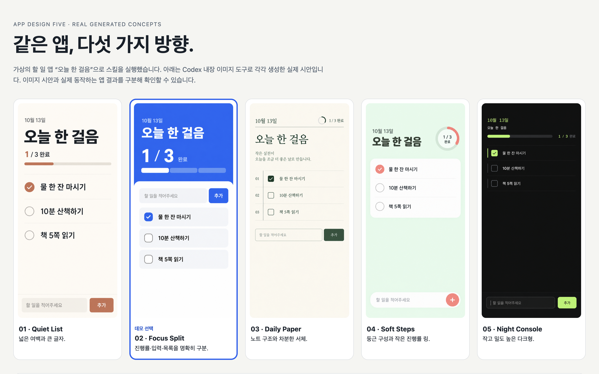
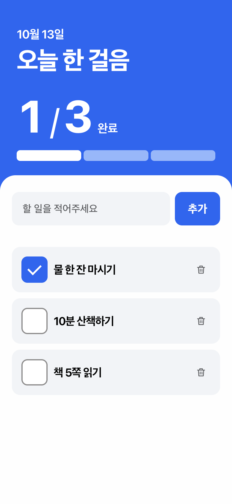

# App Design Five

[한국어](README.md) · [English](README.en.md) · [简体中文](README.zh-CN.md) · [日本語](README.ja.md)

**先展示五张真实的界面设计概念图，再开始制作应用的 AI 智能体技能。**

五张图片 → 用户选择或组合 → 设计制作 → 按要求实现应用

围绕同一个应用核心界面，比较五种不同的设计方向。可以选择其中一种，也可以组合，例如“方案 1 的布局，加上方案 4 的配色”。选定方向后，通过 OpenDesign 的 Local Codex 模式制作设计；只有在用户要求实现应用时才继续编写应用。普通错误修复和状态查询不会启动这套流程。

## 实际运行示例

使用虚构的韩语待办应用 **“오늘 한 걸음”（今天迈一步）**，实际完成了五张图片生成 → 方案选择 → OpenDesign 的 Local Codex 模式 → 可交互应用。用户委托 Codex 选择，最终采用方案 2。Aside 浏览器中的 **15 项检查全部通过**，涵盖交互、保存、错误处理及两种浏览器框架尺寸。





[运行示例与验证记录](demo/README.md) · [应用 HTML](demo/app/index.html) · [韩语 GeekNews 草稿](promotion/geeknews.md) · [韩语 Threads 草稿](promotion/threads.md)

GitHub 显示 HTML 源码。下载仓库后，在浏览器中打开 `demo/app/index.html` 即可操作。移动版截图来自 390×844 浏览器框架，尚未进行手机真机验证。

## 工作流程

1. 明确应用目标、平台、核心界面和必需功能。
2. 使用 Codex 图像工具，生成并展示 **五张独立的真实图片**，让布局和信息结构有所区别。
3. 由用户选择、组合方向或提出修改意见。没有选定方向时，不开始下一步的设计制作。
4. 在 OpenDesign 中制作选定设计。默认执行模式为 **Local Codex**。
5. 如果用户要求实现应用，就制作实际界面和功能；如果只要求设计，则在设计阶段结束。

## 技能与 MCP

| 形式 | 作用 | 本项目的用法 |
| --- | --- | --- |
| 技能 | 向 AI 智能体提供任务步骤和判断标准。 | 以 `SKILL.md` 和参考文档的形式分发。 |
| MCP | 连接 AI 智能体与程序提供的工具或资源。 | 设计阶段使用已有的 OpenDesign 连接。 |

本仓库是一个 **技能包**，不包含独立 MCP 服务器、图像引擎、OpenDesign 程序、API 密钥或生成额度。

## 环境要求

| 宿主 | 技能文档 | 图片生成 | 设计与实现 |
| --- | --- | --- | --- |
| Codex | 通用 Agent Skills 格式 | 需要已安装的 `imagegen` 技能和内置图像工具 | 已安装并完成认证的 OpenDesign + Local Codex |

技能和图像生成在 **Codex** 中运行；选定设计由 **OpenDesign 的 Local Codex 模式**制作。安装本技能不会自动安装或认证 OpenDesign。缺少工具的阶段会保持未完成状态，不会自动切换到付费 API、Cloud 或 BYOK。

## 安装

可以选择使用已有的 `skills` CLI 安装。此方式需要 Node.js/npm，并会运行外部安装工具。

```sh
npx skills add dudqks0319-cpu/app-design-five --skill app-design-five -g -a codex
```

如果不想使用额外安装工具，可下载仓库 ZIP 或克隆仓库，然后 **在仓库文件夹内** 执行以下命令。已有的同名技能不会被覆盖。

```sh
mkdir -p "$HOME/.agents/skills"
if [ -e "$HOME/.agents/skills/app-design-five" ] || [ -L "$HOME/.agents/skills/app-design-five" ]; then
  echo '已存在同名技能。替换前请先检查现有内容。'
else
  mkdir "$HOME/.agents/skills/app-design-five" &&
  cp -R SKILL.md LICENSE agents references "$HOME/.agents/skills/app-design-five/"
fi
```

如需仅在一个项目中使用，请把相同文件放到 `.agents/skills/app-design-five/`。不要在用户目录和项目目录中重复安装同名技能。安装后，请在当前宿主的技能列表中确认是否已被发现。

## 使用示例

```text
使用 $app-design-five 制作一个记账应用。
先展示五张设计概念图。我选定后，再继续用 OpenDesign 制作设计。
```

```text
使用 $app-design-five，只提供设计方案。暂时不要修改应用代码。
```

```text
把方案 1 的列表结构与方案 4 的配色结合起来。字号再大一些。
```

在 OpenDesign 中继续使用已有概念图：

```text
使用 $app-design-five。我选择已有图片中的方案 3。
请用 OpenDesign 的 Local Codex 模式制作这个方向的设计，再应用到应用中。
```

保留用户选定的方向、执行模式，以及实现和验证的范围。本技能本身不授权启动额外智能体、付费、部署或发布到 GitHub。

## 已确认范围与限制

- 已检查技能格式、内部文档链接和本地安装文件的一致性，并观察到该技能出现在 Codex 技能目录中。
- 2026-10-13，上述虚构示例实际完成“五张图片 → 选择 → OpenDesign 的 Local Codex 模式 → 导出应用 → 浏览器检查”。这是单个案例的证据，不代表所有应用或环境均得到验证。
- 需求收集、确认及启动任务需要在同一 MCP 连接中完成。任务启动后，使用相同标识重新连接并查询结果成功。已补充[实际观察到的连接条件](references/tool-routing.md#connection-and-artifact-handling-observed-in-the-demo)。
- 尚未在本项目中验证外部安装 CLI 命令。
- 图片、设计结果、源码实现、本地检查、真机使用和发布状态会分别根据实际证据报告。跳过验证时会明确说明。

## 文件与隐私

统一使用英文 `SKILL.md` 作为智能体执行指引，使用说明提供四种语言版本。`agents/openai.yaml` 为 Codex 界面元数据，`references/` 说明工具路由和选定设计的交接方式。

一般任务的生成图片和私人需求说明应存放在目标应用的本地任务文件夹中。经明确授权公开的虚构示例图片、应用源码和整理后的验证记录位于 `demo/`。分发内容不包括 `.local/` 记录、个人截图或认证信息。本包不包含安装程序、后台脚本、远程数据采集或自动更新功能。示例应用包含仅在浏览器内运行的 JavaScript 和本地保存功能。

## 许可与参考

[MIT 许可证](LICENSE)。本技能为独立实现，参考了用户介绍的 [oil-ui](https://github.com/oil-oil/oil-ui) 中比较多个设计方向的思路，没有包含该仓库的代码、技能正文或图片。

[Agent Skills 标准](https://agentskills.io/home) · [Codex 技能](https://learn.chatgpt.com/docs/build-skills) · [OpenDesign](https://open-design.ai/) · [skills CLI](https://github.com/vercel-labs/skills) · [MCP](https://modelcontextprotocol.io/docs/learn/architecture)
