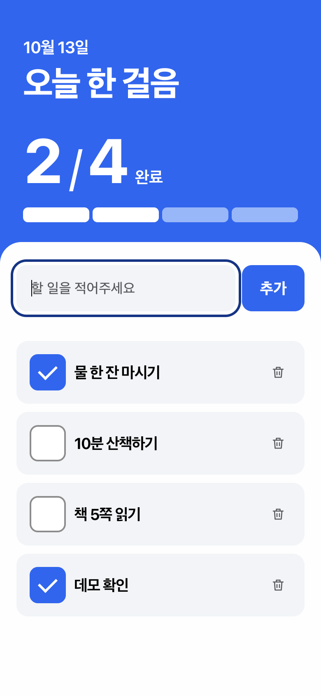

# Executed demo — 오늘 한 걸음

**Five real image concepts → delegated selection → OpenDesign with Local Codex → an interactive task app.** Executed on 2026-10-13. The exported app passed 15 checks in the actual Aside browser. This is one fictional test case; physical phones and other browsers were not tested.

[한국어 안내](../README.md) · [English](../README.en.md) · [简体中文](../README.zh-CN.md) · [日本語](../README.ja.md)

## Try it

1. Download the repository ZIP from GitHub's **Code → Download ZIP**, then extract it.
2. Open `demo/app/index.html` in a browser. No build, package installation, API key or server account is required. File-URL storage behavior varies by browser; a storage warning means changes may not persist.
3. Add a task, toggle its checkbox, delete it, and reload to check persistence in your environment.

For the same HTTP setup used in verification, from the repository folder run:

```sh
python3 -m http.server 8000 --bind 127.0.0.1 --directory demo
```

Open [the localhost gallery](http://127.0.0.1:8000/) or [the localhost app](http://127.0.0.1:8000/app/index.html). Stop the server with Ctrl+C when finished. It serves only `demo/` on your own computer. These links work only while your server is running; no public hosted demo was deployed.

## Five image concepts


| Concept | Main direction | Original raster |
| --- | --- | --- |
| 1 · Quiet List | Ivory, spacious list, large type | [PNG](images/01-quiet-list.png) |
| 2 · Focus Split | Blue progress area, white input/list area | [PNG](images/02-focus-split.png) |
| 3 · Daily Paper | Numbered notebook layout, green serif type | [PNG](images/03-daily-paper.png) |
| 4 · Soft Steps | Mint/coral, rounded list, progress ring | [PNG](images/04-soft-steps.png) |
| 5 · Night Console | Dark, compact list, lime indicators | [PNG](images/05-night-console.png) |

Each PNG was generated separately with Codex's built-in image tool and inspected. The comparison page displays those files; it did not generate or replace them. All concepts use the same fictional task screen and sample tasks. Concept 3 added decorative copy; concept 4 rendered a plus button instead of the requested “추가” label. Those deviations are retained visibly rather than presented as perfect text fidelity.

The user explicitly delegated selection to Codex. Option **2** was selected because its Korean labels, input and progress hierarchy were clear. A local reference path and written visual/functional handoff were supplied to OpenDesign. This was not an API image attachment; the run evidence showed the selected file being inspected.

## Actual implementation




[Desktop capture](screenshots/desktop-1280x900.png) · [Exported app source](app/index.html)

OpenDesign plugin **0.5.2**, application **0.24.1**, and the authenticated **Local Codex** runtime produced the HTML. The same run reached `succeeded`, with a valid deliverable and `index.html` entry. That entry was exported without modifying the app code. The gallery and frame host were added separately to display and inspect it.

The app uses real DOM controls, CSS tokens and JavaScript behavior. It preserves the selected blue/white structure rather than placing the image over the screen. It has add, complete, delete, progress, empty/invalid states and local persistence. The fixed date is fictional demo content, not a live calendar feature.

`app/index.html` SHA-256:

```text
eb23cb8abe9f6b5d381ca55f84fc0a8f23523d8463a91de880fe88fb5bc1cec5
```

[Manifest](manifest.json) records hashes for the app, original images and accepted screenshots. Browser captures are unedited PNGs at device-pixel ratio 2. The mobile app frame is 390×844 CSS pixels (780×1688 PNG); the desktop frame is 1280×900 inside a 1440×900 page capture. Frame sizes do not constitute physical-device testing.

## Browser verification

The 15 checks below used the exported app served over localhost in **Aside Browser**. Button/checkbox clicks, keyboard entry and page navigation were real browser operations. Corrupt/empty/limit storage fixtures and a simulated quota error were deliberately injected for negative-path checks.

| # | Check | Observed result |
| --- | --- | --- |
| 1 | Initial fixture | 3 tasks; 1/3 complete |
| 2 | Blank input | Rejected with visible guidance |
| 3 | Add button | Fourth task added; input cleared |
| 4 | Checkbox | Progress changed to 2/4 |
| 5 | Delete | Task removed; progress returned to 1/3 |
| 6 | Enter key | Task added from the input |
| 7 | Reload/navigation | Added task and completion persisted |
| 8 | HTML-like input | Displayed as text; no injected image or script execution |
| 9 | Input bound | `maxlength=80` present |
| 10 | Corrupt saved JSON | Visible recovery notice; 3 sample tasks restored |
| 11 | Empty saved list | Empty-state message; 0/0 progress |
| 12 | 100-task limit | Next task refused with guidance |
| 13 | Injected storage write failure | In-memory use continued; persistence warning visible |
| 14 | 390×844 browser frame | No horizontal overflow; 3 tasks; measured controls at least 44×44 |
| 15 | 1280×900 browser frame | No horizontal overflow; 3 tasks |

Result: **15/15 passed**. [Sanitized observations](verification.json) contain the check results and fictional values. The screenshot capture issue encountered during QA was corrected by taking page captures with an explicit clip; rejected captures and private runtime logs are excluded. Gallery, initial, changed-state and desktop captures were visually inspected before inclusion.

OpenDesign also reported 21 scenarios in a simulated DOM and native syntax validation. Those are separate from the 15 actual browser checks above and are not added to the browser count.

## Integration findings

- A short-lived MCP connection between `collect_brief` and `confirm_brief` lost the draft in this installed version. No design run started from that failed attempt. The user explicitly approved recollecting the brief, and collection → confirmation → run start then succeeded in one connection.
- After the run was accepted, a fresh connection successfully retrieved the **same run** using its original identifiers. No replacement run or Cloud/BYOK fallback was started.
- Artifact auto-discovery initially failed. Supplying the exact `artifactRef.entryFile` (`index.html`) returned complete, untruncated source.
- The task-owned MCP bridges closed with no remaining owned process-group members. The shared OpenDesign and Aside applications were preserved.

[Reusable routing guidance](../references/tool-routing.md#connection-and-artifact-handling-observed-in-the-demo) incorporates these observations. No machine-specific bridge scripts or credentials are distributed.

## Security and remaining limits

The demo has no backend, paid API, remote fonts, third-party scripts, telemetry or production deployment. CSP blocks network connections; task output uses `textContent`. Input/storage validation bounds titles to 80 JavaScript code units, tasks to 100, and serialized storage to 64 KiB. Invalid stored records are rejected. Save failures remain visible. These controls were reviewed with the relevant local-app security gate; HTML-like input and failure handling were also exercised in the browser.

Task data stays in the browser's `app-design-five-demo-v1` localStorage entry. It is not encrypted, and scripts sharing the same origin can read it; use fictional data. The app's persistence warning covers unavailable storage, and corrupt demo data is replaced with sample data after a visible notice. This is a demonstration, not a production task manager.

Physical-device use, other browsers, automatic skill selection, the external `npx skills add` installation route, and production hosting were not verified. No GeekNews or Threads post was submitted. Private briefs, account details, workflow/run identifiers and raw logs remain outside the public package.
